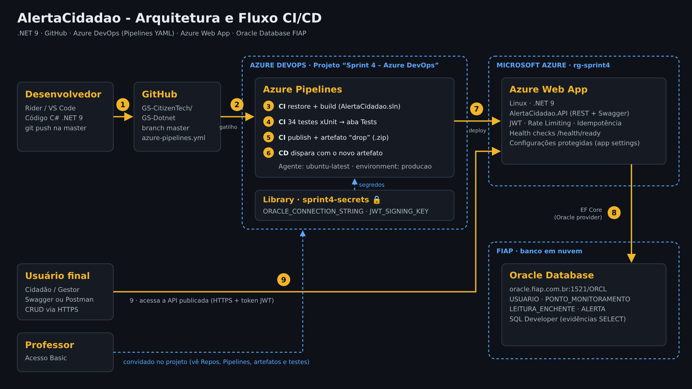

# Alerta Cidadão — CitizenTech

Sistema de monitoramento e gerenciamento de alertas relacionados a enchentes, desenvolvido em .NET 10, com integração ao banco de dados Oracle e recursos de segurança, confiabilidade e monitoramento.

## Integrantes

- Lucas Rafael Solimene / RM: 565194 / Turma: 2TDSPF
- Samyr Couto Oliveira / RM: 565562 / Turma: 2TDSPF
- Henrique Teixeira Cesar / RM: 563088 / Turma: 2TDSPF

## Sobre o projeto

O **Alerta Cidadão** é uma solução voltada à iniciativa CitizenTech, com o objetivo de apoiar o monitoramento de situações de risco relacionadas a enchentes.

A aplicação disponibiliza uma API REST para gerenciamento de usuários e informações relacionadas aos alertas, incorporando mecanismos para proteger os endpoints, evitar a duplicidade de operações e monitorar a disponibilidade da aplicação e de suas dependências.

## Funcionalidades implementadas

- **Gerenciamento de usuários:** endpoints para operações relacionadas aos usuários.
- **Documentação da API:** documentação interativa utilizando Swagger/OpenAPI.
- **Idempotência:** evita a execução duplicada de operações quando uma requisição é repetida com a mesma chave.
- **Rate Limiting:** controla a quantidade de requisições recebidas e protege a API contra excesso de chamadas.
- **Autenticação JWT:** autenticação baseada em tokens para proteger os endpoints.
- **Autorização por perfil:** controle de acesso conforme o papel do usuário.
- **Health Checks:** monitoramento da disponibilidade da API e da conexão com o Oracle.
- **Testes automatizados:** testes unitários e de integração para validar os principais recursos da aplicação.

## Tecnologias utilizadas

| Tecnologia | Finalidade |
|---|---|
| C# | Linguagem de programação |
| .NET 10 | Plataforma de desenvolvimento |
| ASP.NET Core | Construção da API REST |
| Oracle Database | Banco de dados relacional |
| Entity Framework Core | Persistência e acesso a dados |
| JWT Bearer | Autenticação |
| Swagger / OpenAPI | Documentação e testes da API |
| xUnit | Testes automatizados |
| Git e GitHub | Versionamento do projeto |
| Azure DevOps (Pipelines YAML) | CI/CD: build, testes, artefato e deploy |
| Azure Web App (Linux) | Hospedagem da API em nuvem |
| Oracle Database FIAP | Banco de dados em nuvem |

## Arquitetura da solução + Fluxo CI/CD



1. O desenvolvedor faz commit e `git push` na branch `master` do GitHub.
2. O push dispara automaticamente a pipeline no Azure DevOps (`azure-pipelines.yml`).
3. **CI:** restore e build da `AlertaCidadao.sln` com .NET 10.
4. **CI:** execução dos 34 testes automatizados (xUnit), com resultados publicados na aba *Tests*.
5. **CI:** publish da API e publicação do artefato `drop` no Azure DevOps.
6. **CD:** o stage de deploy começa somente após o novo artefato ser gerado com sucesso.
7. **CD:** as configurações protegidas são aplicadas e o artefato é implantado no Azure Web App.
8. A API acessa o Oracle Database da FIAP via Entity Framework Core.
9. O usuário final (cidadão ou gestor) consome a API publicada via HTTPS com token JWT.

O professor é convidado no projeto do Azure DevOps com acesso **Basic**.

## Pipeline CI/CD (Azure DevOps)

| Stage | Task | O que faz |
|---|---|---|
| CI | UseDotNet | Instala o .NET 10 no agente |
| CI | Restore / Build | Restaura pacotes e compila a solução em Release |
| CI | DotNetCoreCLI test | Executa os testes e publica os resultados |
| CI | DotNetCoreCLI publish | Gera o pacote .zip da `AlertaCidadao.API` |
| CI | PublishBuildArtifacts | Publica o artefato `drop` |
| CD | AzureAppServiceSettings | Grava a connection string do Oracle e a chave JWT no Web App |
| CD | AzureWebApp | Faz o deploy do artefato no Azure Web App (Linux, .NET 10) |

**Variáveis protegidas:** o variable group `sprint4-secrets` (Pipelines > Library) guarda `ORACLE_CONNECTION_STRING` e `JWT_SIGNING_KEY` como secretas. Nenhuma senha ou chave fica no repositório.

**Aplicação publicada:** `app-alertacidadao-rm563088-ckgwcwdhgubua2aa.brazilsouth-01.azurewebsites.net` · Swagger em `/swagger` · Health check em `/health/ready`

### Evidências do CRUD no banco

```sql
SELECT * FROM PONTO_MONITORAMENTO;                      -- após o POST
SELECT * FROM PONTO_MONITORAMENTO WHERE ID_PONTO = :id; -- após GET, PUT e DELETE (ATIVO = 0)
```

## Arquitetura do projeto

A solução utiliza uma organização em camadas para separar as responsabilidades da aplicação.

```text
GS-.NET/
│
├── src/
│   ├── AlertaCidadao.API/
│   │   ├── Authentication/
│   │   ├── Endpoints/
│   │   ├── Extensions/
│   │   ├── Filters/
│   │   └── HealthChecks/
│   │
│   ├── AlertaCidadao.Application/
│   │
│   ├── AlertaCidadao.Domain/
│   │
│   └── AlertaCidadao.Infrastructure/
│
├── test/
│   └── AlertaCidadao.UnitTests/
│
├── docs/
│   ├── arquitetura.png
│   └── HealthChecks.md
│
├── azure-pipelines.yml
└── AlertaCidadao.sln
```

### Responsabilidades das camadas

- **API:** disponibiliza os endpoints HTTP, autenticação, autorização, filtros e configurações da aplicação.
- **Application:** concentra os serviços e as regras de aplicação.
- **Domain:** contém as entidades e regras centrais do domínio.
- **Infrastructure:** implementa os recursos de infraestrutura, incluindo persistência e acesso ao Oracle.
- **UnitTests:** contém os testes automatizados da solução.

## Pré-requisitos

Antes de executar o projeto, é necessário ter instalado:

- [.NET 10 SDK](https://dotnet.microsoft.com/download/dotnet/9.0)
- [Oracle Database](https://www.oracle.com/database/)
- [Git](https://git-scm.com/)
- Visual Studio ou Visual Studio Code (opcional)

## Configuração do projeto

As configurações sensíveis devem ser armazenadas utilizando o **.NET User Secrets**, evitando a inclusão de senhas, chaves JWT e credenciais no repositório.

Acesse a pasta da API:

```powershell
cd src/AlertaCidadao.API
```

Inicialize o User Secrets, caso ainda não esteja configurado:

```powershell
dotnet user-secrets init
```

Configure a conexão com o Oracle:

```powershell
dotnet user-secrets set "ConnectionStrings:Oracle" "SUA_CONNECTION_STRING"
```

Configure os parâmetros de autenticação JWT:

```powershell
dotnet user-secrets set "Jwt:Issuer" "AlertaCidadao.API"
dotnet user-secrets set "Jwt:Audience" "AlertaCidadao.Client"
dotnet user-secrets set "Jwt:SigningKey" "SUA_CHAVE_SECRETA"
dotnet user-secrets set "Jwt:ExpirationMinutes" "60"
```

> Utilize os mesmos valores de Issuer, Audience e demais configurações esperados pela aplicação. A chave JWT deve ser forte e mantida em segredo.

## Como executar a aplicação

Na raiz do repositório, restaure as dependências:

```powershell
dotnet restore .\AlertaCidadao.sln
```

Compile a solução:

```powershell
dotnet build .\AlertaCidadao.sln
```

Execute a API:

```powershell
dotnet run --project .\src\AlertaCidadao.API
```

A aplicação estará disponível em:

```text
http://localhost:5075
```

## Documentação da API

Com a aplicação em execução, acesse a interface Swagger:

```text
http://localhost:5075/swagger
```

O Swagger permite visualizar os endpoints, consultar os parâmetros das requisições e realizar testes diretamente pelo navegador.

Para acessar endpoints protegidos, utilize o mecanismo **Authorize** do Swagger e informe um token JWT válido.

## Recursos de segurança e confiabilidade

### Idempotência

A API utiliza chaves de idempotência para impedir que uma mesma operação seja executada repetidamente quando uma requisição é reenviada.

Comportamentos implementados:

- Uma repetição com a mesma chave e os mesmos dados retorna a resposta original.
- A mesma chave utilizada com dados diferentes retorna HTTP 409 (Conflict).
- Requisições sem chave continuam seguindo o fluxo normal.
- Chaves inválidas são rejeitadas.
- O mecanismo trata requisições concorrentes conforme a implementação de persistência da aplicação.

### Rate Limiting

Foram implementadas políticas de limitação de requisições para controlar o volume de chamadas à API.

O mecanismo contempla:

- Política global.
- Política específica para login.
- Política específica para cadastro.
- Resposta HTTP 429 (Too Many Requests) quando o limite é excedido.
- Cabeçalho `Retry-After` para informar o intervalo de espera.

### Autenticação e autorização JWT

A API utiliza JWT Bearer para autenticar os usuários.

O mecanismo contempla:

- Geração e validação de tokens.
- Validação de emissor e audiência.
- Validação da assinatura do token.
- Controle de expiração.
- Autorização baseada em perfil de acesso.

Respostas esperadas para situações de acesso:

| Situação | HTTP |
|---|---:|
| Token ausente ou inválido | 401 |
| Usuário sem permissão | 403 |
| Acesso autorizado | 200 |

### Health Checks

A aplicação disponibiliza endpoints para monitorar sua disponibilidade e a conexão com o banco de dados.

| Endpoint | Finalidade |
|---|---|
| `/health/live` | Verifica se a aplicação está em execução. |
| `/health/ready` | Verifica se a aplicação está pronta para atender requisições, considerando a dependência Oracle. |
| `/health` | Apresenta o estado geral da aplicação e suas verificações. |

Os endpoints retornam informações estruturadas em JSON e utilizam HTTP 503 quando uma verificação de disponibilidade falha.

## Testes automatizados

A solução possui testes automatizados utilizando xUnit.

Para executar todos os testes:

```powershell
dotnet test .\AlertaCidadao.sln --configuration Release
```

Para executar com informações detalhadas:

```powershell
dotnet test .\AlertaCidadao.sln --configuration Release --logger "console;verbosity=normal"
```

### Cobertura dos testes implementados

Os testes contemplam:

- Autenticação JWT.
- Autorização por perfil.
- Validação de tokens.
- Comportamento de idempotência.
- Reutilização de chaves com dados diferentes.
- Validação de chaves inválidas.
- Limitação de requisições.
- Respostas HTTP 429 e cabeçalho `Retry-After`.
- Health Checks da API.
- Disponibilidade e indisponibilidade da conexão com o Oracle.

**Resultado da execução da suíte:** 34 testes aprovados e 0 falhas.
