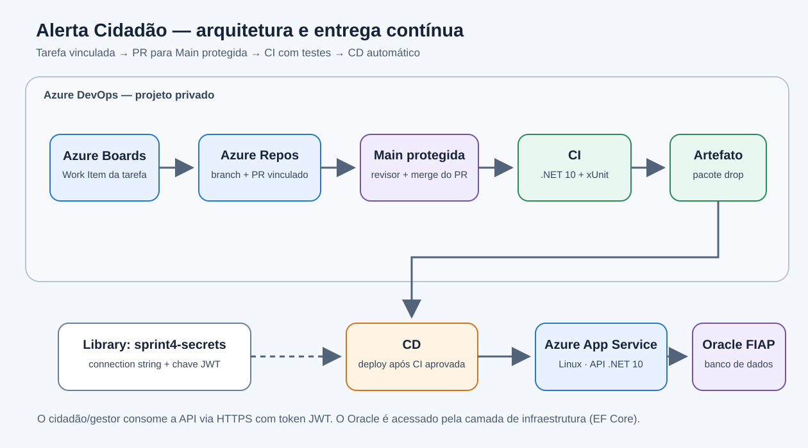

# Alerta Cidadão — CitizenTech

Sistema de monitoramento e gerenciamento de alertas relacionados a enchentes, desenvolvido em .NET 10, com integração ao banco de dados Oracle e recursos de segurança, confiabilidade e monitoramento.

## Integrantes

- Lucas Rafael Solimene / RM: 565194 / Turma: 2TDSPF
- Samyr Couto Oliveira / RM: 565562 / Turma: 2TDSPF
- Henrique Teixeira Cesar / RM: 563088 / Turma: 2TDSPF

## Sobre o projeto

O **Alerta Cidadão** é uma solução voltada à iniciativa CitizenTech, com o objetivo de apoiar o monitoramento de situações de risco relacionadas a enchentes.

A aplicação disponibiliza uma API REST para gerenciamento de usuários e informações relacionadas aos alertas, incorporando mecanismos para proteger os endpoints, evitar a duplicidade de operações e monitorar a disponibilidade da aplicação e de suas dependências.

## Funcionalidades implementadas

- **Gerenciamento de usuários:** endpoints para operações relacionadas aos usuários.
- **Documentação da API:** documentação interativa utilizando Swagger/OpenAPI.
- **Idempotência:** evita a execução duplicada de operações quando uma requisição é repetida com a mesma chave.
- **Rate Limiting:** controla a quantidade de requisições recebidas e protege a API contra excesso de chamadas.
- **Autenticação JWT:** autenticação baseada em tokens para proteger os endpoints.
- **Autorização por perfil:** controle de acesso conforme o papel do usuário.
- **Health Checks:** monitoramento da disponibilidade da API e da conexão com o Oracle.
- **Testes automatizados:** testes unitários e de integração para validar os principais recursos da aplicação.

## Tecnologias utilizadas

| Tecnologia | Finalidade |
|---|---|
| C# | Linguagem de programação |
| .NET 10 | Plataforma de desenvolvimento |
| ASP.NET Core | Construção da API REST |
| Oracle Database | Banco de dados relacional |
| Entity Framework Core | Persistência e acesso a dados |
| JWT Bearer | Autenticação |
| Swagger / OpenAPI | Documentação e testes da API |
| xUnit | Testes automatizados |
| Git e Azure Repos | Versionamento do projeto |
| Azure Boards | Tarefas ligadas a branches, commits e pull requests |
| Azure DevOps (Pipelines YAML) | CI/CD: build, testes, artefato e deploy |
| Azure Web App (Linux) | Hospedagem da API em nuvem |
| Oracle Database FIAP | Banco de dados em nuvem |

## Arquitetura da solução + Fluxo CI/CD



1. A tarefa é criada no Azure Boards e vinculada à branch e ao pull request.
2. A equipe trabalha em uma branch de tarefa no Azure Repos e abre um PR para `main`.
3. A branch `main` deve exigir revisor, vínculo com Work Item e revisor padrão; alterações entram por merge do PR.
4. O merge na `main` dispara `azure-pipeline.yml`.
5. **CI:** restore, build .NET 10, testes xUnit, publicação dos resultados e artefato `drop`.
6. **CD:** após CI bem-sucedida, configurações protegidas são aplicadas e o pacote é implantado no Azure App Service.
7. A API acessa o Oracle da FIAP pelo Entity Framework Core e atende via HTTPS/JWT.

O projeto no Azure DevOps deve permanecer privado. Adicione o professor com nível **Basic** na organização e **Project Administrators** no projeto, usando o e-mail informado pela FIAP.

Consulte [o roteiro de apresentação e demonstração](docs/roteiro-apresentacao.md) para a ordem sugerida do vídeo e a lista de verificação da entrega.

## Pipeline CI/CD (Azure DevOps)

| Stage | Task | O que faz |
|---|---|---|
| CI | UseDotNet | Instala o .NET 10 no agente |
| CI | Restore / Build | Restaura pacotes e compila a solução em Release |
| CI | DotNetCoreCLI test | Executa os testes e publica os resultados |
| CI | DotNetCoreCLI publish | Gera o pacote .zip da `AlertaCidadao.API` |
| CI | PublishBuildArtifacts | Publica o artefato `drop` |
| CD | AzureAppServiceSettings | Aplica a connection string do Oracle e a chave JWT no Web App |
| CD | AzureWebApp | Faz o deploy do artefato no Azure Web App (Linux, .NET 10) |

**Variáveis protegidas:** o variable group `sprint4-secrets` (Pipelines > Library) guarda `ORACLE_CONNECTION_STRING` e `JWT_SIGNING_KEY` como secretas. Nenhuma senha ou chave fica no repositório.

**Aplicação publicada:** [Alerta Cidadão no Azure](https://app-alertacidadao-rm563088-ckgwcwdhgubua2aa.brazilsouth-01.azurewebsites.net) · Swagger em `/swagger` · Health check em `/health/ready`. O plano existente está em `rg-sprint4`, região Brazil South, SKU gratuito F1.

### Conferência de persistência no banco

```sql
SELECT * FROM USUARIO;
SELECT * FROM PONTO_MONITORAMENTO;
SELECT * FROM LEITURA_ENCHENTE;
SELECT * FROM ALERTA;
SELECT * FROM REQUISICAO_IDEMPOTENCIA;
```

Na gravação, mostre cada POST, GET, PUT e DELETE pelo Swagger e comprove no SQL Developer a persistência de cada uma das cinco tabelas. Para registros com exclusão lógica, confirme a coluna `ATIVO`/`STATUS` depois do DELETE. O GET demonstra a resposta da API; o `SELECT` no Oracle é a evidência de persistência pedida pela entrega.

## Arquitetura do projeto

A solução utiliza uma organização em camadas para separar as responsabilidades da aplicação.

```text
GS-.NET/
│
├── src/
│   ├── AlertaCidadao.API/
│   │   ├── Authentication/
│   │   ├── Endpoints/
│   │   ├── Extensions/
│   │   ├── Filters/
│   │   └── HealthChecks/
│   │
│   ├── AlertaCidadao.Application/
│   │
│   ├── AlertaCidadao.Domain/
│   │
│   └── AlertaCidadao.Infrastructure/
│
├── test/
│   └── AlertaCidadao.UnitTests/
│
├── docs/
│   ├── arquitetura.svg
│   ├── diagram.mmd
│   └── HealthChecks.md
│
├── scripts/
│   ├── provision-azure.sh
│   └── script-bd.sql
├── azure-pipeline.yml
├── azure-pipelines.yml
└── AlertaCidadao.sln
```

### Responsabilidades das camadas

- **API:** disponibiliza os endpoints HTTP, autenticação, autorização, filtros e configurações da aplicação.
- **Application:** concentra os serviços e as regras de aplicação.
- **Domain:** contém as entidades e regras centrais do domínio.
- **Infrastructure:** implementa os recursos de infraestrutura, incluindo persistência e acesso ao Oracle.
- **UnitTests:** contém os testes automatizados da solução.

## Passo a passo: do clone à entrega

Os comandos abaixo são para **Windows usando Git Bash**. Execute-os na ordem e use barras `/` nos caminhos. Não coloque senhas, connection strings ou chaves JWT em arquivos do repositório.

### 1. Instale e confira os programas

Instale o [Git para Windows](https://git-scm.com/download/win) e o [.NET 10 SDK](https://dotnet.microsoft.com/download/dotnet/10.0). Para provisionar recursos na nuvem, instale também o [Azure CLI](https://learn.microsoft.com/cli/azure/install-azure-cli). Você precisa ter acesso aos dados de conexão Oracle fornecidos pela FIAP.

No Git Bash, confira o SDK:

```bash
dotnet --version
```

O resultado deve começar com `10.`.

### 2. Clone o repositório Azure DevOps

No Azure DevOps, abra **Repos > Files > Clone** e confirme que a URL corresponde ao repositório da equipe. No Git Bash:

```bash
cd ~/Desktop
git clone "https://dev.azure.com/alertacidadao-rm563088/Sprint%204%20%E2%80%93%20Azure%20DevOps/_git/Sprint%204%20%E2%80%93%20Azure%20DevOps" GS-Devops
cd GS-Devops
git switch main
git pull origin main
ls
```

Confirme que aparecem `AlertaCidadao.sln`, `src`, `test` e `scripts`. Se a pasta já existir, entre nela com `cd ~/Desktop/GS-Devops` e atualize com `git pull origin main`; não faça outro clone dentro dela.

### 3. Prepare o banco Oracle

No Oracle da FIAP, execute `scripts/script-bd.sql` uma vez para criar as tabelas do projeto. Use o usuário, host, porta e nome do serviço Oracle fornecidos pela FIAP; não use literalmente `HOST` ou `SERVICE_NAME` como valores.

O formato comum da connection string é:

```text
User Id=SEU_RM;Password=SUA_SENHA;Data Source=//HOST_ORACLE:1521/NOME_DO_SERVICO
```

### 4. Configure os segredos para execução local

Na raiz `GS-Devops`, rode. O projeto já contém um `UserSecretsId`, então não é necessário inicializar novamente:

```bash
cd src/AlertaCidadao.API
dotnet user-secrets set "ConnectionStrings:Oracle" "User Id=SEU_RM;Password=SUA_SENHA;Data Source=//HOST_ORACLE:1521/NOME_DO_SERVICO"
dotnet user-secrets set "Jwt:Issuer" "AlertaCidadao.API"
dotnet user-secrets set "Jwt:Audience" "AlertaCidadao.Client"
dotnet user-secrets set "Jwt:SigningKey" "$(openssl rand -hex 32)"
dotnet user-secrets set "Jwt:ExpirationMinutes" "60"
cd ../..
```

Troque os dados Oracle pelos valores reais da FIAP. O comando `openssl` gera uma chave JWT forte. User Secrets ficam na máquina do aluno e não devem ser enviados ao Git.

### 5. Restaure, compile, teste e execute a API

Estes comandos devem ser executados na raiz do repositório. No Git Bash, use os caminhos com `/` abaixo.

```bash
dotnet restore AlertaCidadao.sln
dotnet build AlertaCidadao.sln --configuration Release
dotnet test AlertaCidadao.sln --configuration Release
dotnet run --project src/AlertaCidadao.API
```

Com a API em execução, abra `http://localhost:5075/swagger`. Para encerrar, volte ao Git Bash da API e pressione `Ctrl+C`.

### 6. Crie ou confira os recursos Azure pela Azure CLI

Entre na conta que contém a assinatura autorizada pela FIAP e selecione a assinatura correta:

```bash
az login
az account list --output table
az account set --subscription "ID_OU_NOME_DA_ASSINATURA"
```

Na raiz do repositório, execute o script solicitado na entrega:

```bash
bash scripts/provision-azure.sh
```

O script cria os recursos que estiverem faltando e reutiliza por padrão `rg-sprint4`, região `brazilsouth`, plano Linux F1 e Web App do projeto. Ele cria recursos de hospedagem; **não** cria o banco Oracle nem configura os segredos do pipeline. SKU paga pode gerar cobrança.

### 7. Confira as configurações do Azure Pipelines

Em **Pipelines > Library**, confira o variable group `sprint4-secrets` e configure como secretos `ORACLE_CONNECTION_STRING` e `JWT_SIGNING_KEY`. Confirme que o pipeline está autorizado a usar o grupo. Em **Project Settings > Service connections**, confira `sc-azure-sprint4`; em **Pipelines > Environments**, confira o ambiente `producao`. Não mostre valores secretos na gravação.

### 8. Convide o professor e proteja a branch principal

Mantenha o projeto privado e siga o requisito da FIAP para adicionar o professor: nível **Basic** na organização e **Project Administrators** no projeto, usando somente o e-mail oficial informado pela FIAP. Em **Repos > Branches**, confira que `main` recebe alterações por pull request, exige revisor e exige vínculo com uma tarefa do Azure Boards.

### 9. Crie uma tarefa, uma branch e um pull request

Crie uma tarefa no **Azure Boards**. A partir da tarefa, crie uma branch vinculada, por exemplo `feature/AB123-ajuste-validacao` (troque `123` pelo ID real). Faça uma alteração de código relacionada à tarefa. No Git Bash, adicione o arquivo alterado, faça commit vinculado ao ID e envie a branch:

```bash
git switch -c feature/AB123-ajuste-validacao
git add "CAMINHO_DO_ARQUIVO_ALTERADO"
git commit -m "AB#123 Ajusta validacao da API"
git push -u origin feature/AB123-ajuste-validacao
```

Crie um **Pull Request** da branch para `main`, vincule a tarefa, peça a revisão exigida e conclua o merge após a aprovação. Substitua `123` nos exemplos pelo ID real. Não faça push direto para `main`.

### 10. Confira a execução automática e a publicação

Depois do merge, abra **Pipelines > Runs** e confira a execução disparada para `main`: CI, testes, artefato `drop` e etapa CD precisam terminar com sucesso. Não use apenas uma execução manual como prova do gatilho automático. Confira a API publicada, o Swagger e o health check:

- [API publicada](https://app-alertacidadao-rm563088-ckgwcwdhgubua2aa.brazilsouth-01.azurewebsites.net)
- [Swagger](https://app-alertacidadao-rm563088-ckgwcwdhgubua2aa.brazilsouth-01.azurewebsites.net/swagger)
- [Health check de prontidão](https://app-alertacidadao-rm563088-ckgwcwdhgubua2aa.brazilsouth-01.azurewebsites.net/health/ready)

### 11. Grave e entregue a apresentação

Use [o roteiro de apresentação e demonstração](docs/roteiro-apresentacao.md). Na gravação, mostre o clone, a tarefa e branch vinculadas, o PR e merge, a execução automática completa, a API publicada e as operações POST/GET/PUT/DELETE no Swagger. Comprove a persistência no SQL Developer nas cinco tabelas listadas abaixo; após exclusão lógica, mostre também a coluna de status correspondente. Entregue o PDF com os nomes, RMs, endereço do Azure DevOps e link do vídeo conforme o padrão pedido pela FIAP. Antes de enviar, confirme que o vídeo está acessível ao professor.

O script de provisionamento fica em `scripts/provision-azure.sh`; o DDL do banco fica em `scripts/script-bd.sql`. As tabelas são `USUARIO`, `PONTO_MONITORAMENTO`, `LEITURA_ENCHENTE`, `ALERTA` e `REQUISICAO_IDEMPOTENCIA`.

## Documentação da API

Com a aplicação em execução, acesse a interface Swagger:

```text
http://localhost:5075/swagger
```

O Swagger permite visualizar os endpoints, consultar os parâmetros das requisições e realizar testes diretamente pelo navegador.

Para acessar endpoints protegidos, utilize o mecanismo **Authorize** do Swagger e informe um token JWT válido.

## Recursos de segurança e confiabilidade

### Idempotência

A API utiliza chaves de idempotência para impedir que uma mesma operação seja executada repetidamente quando uma requisição é reenviada.

Comportamentos implementados:

- Uma repetição com a mesma chave e os mesmos dados retorna a resposta original.
- A mesma chave utilizada com dados diferentes retorna HTTP 409 (Conflict).
- Requisições sem chave continuam seguindo o fluxo normal.
- Chaves inválidas são rejeitadas.
- O mecanismo trata requisições concorrentes conforme a implementação de persistência da aplicação.

### Rate Limiting

Foram implementadas políticas de limitação de requisições para controlar o volume de chamadas à API.

O mecanismo contempla:

- Política global.
- Política específica para login.
- Política específica para cadastro.
- Resposta HTTP 429 (Too Many Requests) quando o limite é excedido.
- Cabeçalho `Retry-After` para informar o intervalo de espera.

### Autenticação e autorização JWT

A API utiliza JWT Bearer para autenticar os usuários.

O mecanismo contempla:

- Geração e validação de tokens.
- Validação de emissor e audiência.
- Validação da assinatura do token.
- Controle de expiração.
- Autorização baseada em perfil de acesso.

Respostas esperadas para situações de acesso:

| Situação | HTTP |
|---|---:|
| Token ausente ou inválido | 401 |
| Usuário sem permissão | 403 |
| Acesso autorizado | 200 |

### Health Checks

A aplicação disponibiliza endpoints para monitorar sua disponibilidade e a conexão com o banco de dados.

| Endpoint | Finalidade |
|---|---|
| `/health/live` | Verifica se a aplicação está em execução. |
| `/health/ready` | Verifica se a aplicação está pronta para atender requisições, considerando a dependência Oracle. |
| `/health` | Apresenta o estado geral da aplicação e suas verificações. |

Os endpoints retornam informações estruturadas em JSON e utilizam HTTP 503 quando uma verificação de disponibilidade falha.

## Testes automatizados

A solução possui testes automatizados utilizando xUnit.

Para executar todos os testes:

```powershell
dotnet test AlertaCidadao.sln --configuration Release
```

Para executar com informações detalhadas:

```powershell
dotnet test AlertaCidadao.sln --configuration Release --logger "console;verbosity=normal"
```

### Cobertura dos testes implementados

Os testes contemplam:

- Autenticação JWT.
- Autorização por perfil.
- Validação de tokens.
- Comportamento de idempotência.
- Reutilização de chaves com dados diferentes.
- Validação de chaves inválidas.
- Limitação de requisições.
- Respostas HTTP 429 e cabeçalho `Retry-After`.
- Health Checks da API.
- Disponibilidade e indisponibilidade da conexão com o Oracle.

**Resultado da execução da suíte:** 34 testes aprovados e 0 falhas.
